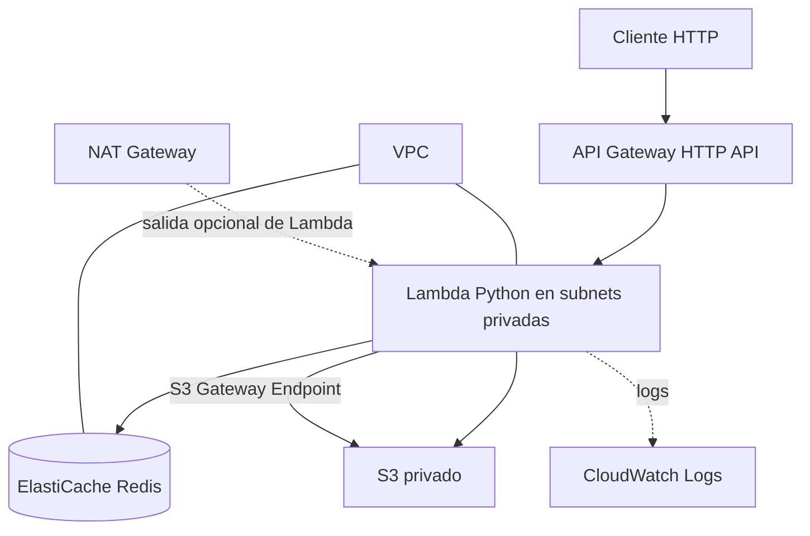

# SRE Data Processor — AWS + Terraform

Infraestructura de ejemplo para una API HTTP que procesa solicitudes, usa Redis como caché y persiste resultados en S3.

> Estado: código inicial para revisión y pruebas. No afirmar despliegue exitoso hasta ejecutar `terraform apply` en una cuenta AWS o un entorno compatible. LocalStack no garantiza paridad completa con AWS para VPC/NAT/ElastiCache.

## Arquitectura



## Requisitos

- Terraform >= 1.5
- AWS CLI v2
- Python 3.11/3.12 recomendado para empaquetado Lambda (runtime definido en Terraform)
- Cuenta AWS con permisos para VPC, EC2, Lambda, IAM, API Gateway, S3, ElastiCache y CloudWatch
- Para pruebas locales opcionales: Docker Desktop + LocalStack; revisar limitaciones de compatibilidad.

## Despliegue real en AWS

1. Configura credenciales con `aws configure` o un perfil SSO.
2. Entra a `terraform/`.
3. Copia `terraform.tfvars.example` a `terraform.tfvars` y ajusta `project_name`, región y CIDR si lo necesitas.
4. Ejecuta:
   ```powershell
   terraform init
   terraform fmt -recursive
   terraform validate
   terraform plan
   terraform apply
   ```
5. Para probar:
   ```powershell
   $url = terraform output -raw api_url
   $body = '{"text":"hola SRE"}'
   curl.exe -i -X POST "$url/process" -H "Content-Type: application/json" -d $body
   curl.exe -i -X POST "$url/process" -H "Content-Type: application/json" -d $body
   ```
   La primera respuesta debe incluir `X-Cache: MISS`; la segunda `X-Cache: HIT`.
6. Comprueba objetos:
   ```powershell
   aws s3 ls "s3://$(terraform output -raw bucket_name)/results/" --recursive
   ```
7. Captura las respuestas y la salida de S3 en `evidence/`. No incluyas credenciales ni secretos en Git.

## Decisiones

- **HTTP API**: menor complejidad para una integración proxy sencilla; suficiente para `POST /process`.
- **Python**: permite un handler legible y fácil de mantener.
- **Redis TTL 60 s**: limita la vida de las claves de caché.
- **S3 privado**: bloqueo de acceso público, versionado y acceso de Lambda mediante IAM.
- **Subnets privadas**: Lambda y Redis no tienen IP pública. NAT se incluye para salida general; el tráfico a S3 usa Gateway Endpoint.
- **Costos**: NAT Gateway y ElastiCache pueden generar cargos. Ejecuta `terraform destroy` al terminar si ya no necesitas los recursos.

## Limitaciones y pendientes de validación

Este repositorio debe pasar `terraform validate` y luego probarse en el entorno objetivo. La disponibilidad de tipos de nodo, zonas y ciertos recursos varía por región. En particular, verifica el soporte de `cache.t3.micro` en la región elegida. La Lambda usa un paquete ZIP construido por Terraform; `lambda/requirements.txt` contiene dependencias externas y debe empaquetarse para Linux compatible con Lambda. Para producción se recomienda pipeline de build reproducible, cifrado explícito, alarmas, pruebas y control de costos.
