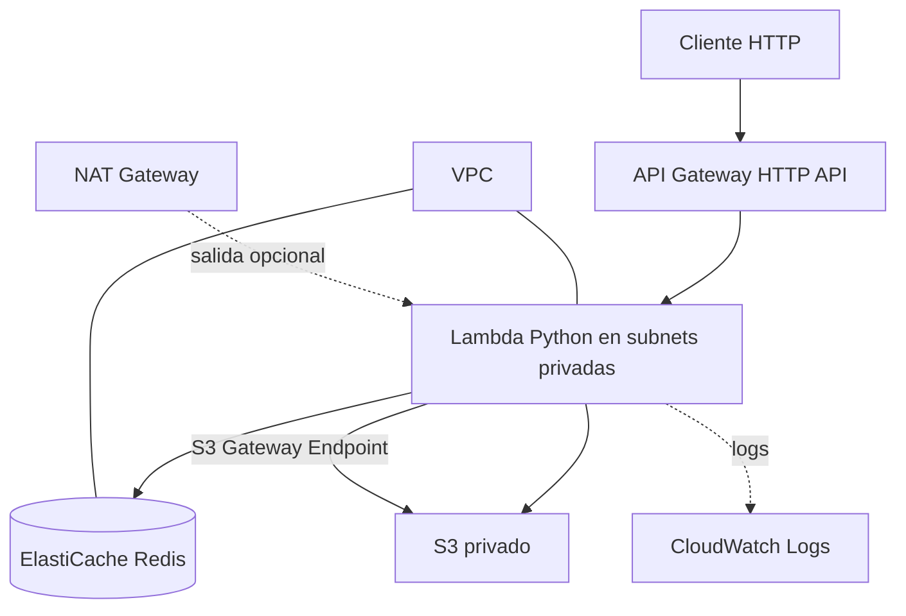

# SRE Data Processor — AWS + Terraform

Infraestructura de ejemplo para una API HTTP que procesa solicitudes, utiliza Redis como caché y almacena resultados en Amazon S3.

> **Estado del proyecto:** configuración validada con Terraform y pruebas funcionales realizadas en entornos locales y LocalStack. No se ha realizado un despliegue real en AWS. LocalStack no garantiza compatibilidad completa con todos los servicios y recursos de AWS.

## Arquitectura



## Componentes

- **API Gateway:** expone el endpoint HTTP de procesamiento.
- **AWS Lambda:** procesa las solicitudes y genera los resultados.
- **Redis / ElastiCache:** almacena resultados en caché con expiración TTL.
- **Amazon S3:** almacena los resultados procesados como objetos JSON.
- **IAM:** define los permisos necesarios para la ejecución de Lambda.
- **VPC y subnets privadas:** separan los componentes de la infraestructura.
- **CloudWatch Logs:** permite consultar los registros de ejecución.

## Requisitos

Para trabajar con la configuración del proyecto:

- Terraform >= 1.5.
- AWS CLI v2.
- Python compatible con el runtime definido en Terraform.
- PowerShell en Windows.
- Docker Desktop para las pruebas locales con Redis y LocalStack.

Para un despliegue real también se requiere una cuenta AWS con permisos suficientes para crear los recursos de la arquitectura.

## Estructura del repositorio

```text
.
├── docs/
│   └── test-results.md
├── evidence/
│   ├── README.md
│   ├── cache-miss-hit.png
│   └── invalid-json.png
├── lambda/
│   ├── build.ps1
│   ├── handler.py
│   └── requirements.txt
├── terraform/
│   ├── api_gateway.tf
│   ├── cache.tf
│   ├── iam.tf
│   ├── lambda.tf
│   ├── networking.tf
│   ├── outputs.tf
│   ├── providers.tf
│   ├── security.tf
│   ├── storage.tf
│   ├── variables.tf
│   └── versions.tf
├── terraform-local/
├── docker-compose.yml
├── local_api.py
└── README.md
```

## Pruebas realizadas

### API local con Flask y Redis

Se documentaron pruebas locales de procesamiento, caché, expiración de claves, JSON inválido, indisponibilidad y recuperación de Redis, y almacenamiento en archivos JSON locales.

Los resultados detallados se encuentran en `docs/test-results.md`.

### Lambda y servicios emulados con LocalStack

Se verificaron los siguientes comportamientos en el entorno local:

- Procesamiento de un evento válido con respuesta HTTP 200.
- Primera solicitud con `X-Cache: MISS`.
- Segunda solicitud equivalente con `X-Cache: HIT`.
- Solicitud con JSON inválido y respuesta HTTP 400.
- Almacenamiento y recuperación de un objeto JSON en S3 de LocalStack.

Estas pruebas no demuestran por sí solas el funcionamiento de la arquitectura desplegada en AWS real.

### Validación de Terraform

La configuración principal pasó la validación:

```powershell
terraform -chdir=terraform validate
```

Resultado esperado:

```text
Success! The configuration is valid.
```

Esta validación comprueba la estructura y la sintaxis de la configuración, pero no confirma que todos los recursos puedan desplegarse correctamente en AWS.

## Preparación del paquete Lambda

Desde la raíz del proyecto, ejecuta:

```powershell
powershell -ExecutionPolicy Bypass -File ".\lambda\build.ps1"
```

El script prepara los archivos necesarios para empaquetar la función. Antes de un despliegue real, verifica que las dependencias sean compatibles con el runtime y el entorno de ejecución de Lambda.

## Despliegue real en AWS — pendiente

**No ejecutes este procedimiento hasta contar con una cuenta AWS autorizada, revisar los costes y confirmar que deseas crear recursos reales.**

1. Configura las credenciales mediante un perfil AWS o AWS IAM Identity Center.
2. Entra en la carpeta `terraform/`.
3. Copia `terraform.tfvars.example` como `terraform.tfvars` y revisa los valores.
4. Inicializa y valida la configuración:

   ```powershell
   terraform init
   terraform fmt -recursive
   terraform validate
   terraform plan
   ```

5. Revisa el plan y los costes estimados antes de considerar `terraform apply`.
6. Después de un despliegue autorizado, consulta la URL de la API y prueba el endpoint configurado.
7. Comprueba los objetos generados en S3 y los registros en CloudWatch.
8. Si ya no necesitas los recursos, planifica su eliminación y verifica qué recursos y datos se perderían.

No se debe ejecutar `terraform apply` sin revisar previamente el plan y los permisos.

## Decisiones de diseño

- **HTTP API:** reduce la complejidad para exponer una operación HTTP.
- **Python:** permite mantener un handler legible y sencillo de probar.
- **Redis con TTL:** limita la permanencia de las entradas de caché.
- **S3 privado:** almacena resultados sin habilitar acceso público.
- **Subnets privadas:** evitan asignar direcciones IP públicas directamente a Lambda y Redis.
- **IAM:** permite limitar los permisos de ejecución a las operaciones necesarias.

## Seguridad y costes

- No guardes credenciales, tokens ni archivos `.env` en Git.
- No publiques estados ni planes de Terraform.
- Revisa los permisos IAM antes de cualquier despliegue.
- NAT Gateway, ElastiCache y otros recursos pueden generar cargos.
- Usa LocalStack para pruebas locales, sin asumir que reproduce por completo el comportamiento de AWS.
- Mantén las credenciales fuera del código y utiliza mecanismos seguros de configuración.

## Limitaciones y trabajo pendiente

- Desplegar y validar la arquitectura en una cuenta AWS real.
- Verificar los permisos IAM y la conectividad de red.
- Confirmar la compatibilidad de los tipos de nodo y recursos en la región seleccionada.
- Comprobar la API Gateway, Lambda, S3 y CloudWatch en AWS.
- Ampliar las pruebas automatizadas y documentar los resultados con evidencias verificables.
- Revisar el empaquetado reproducible, la observabilidad y el control de costes.

## Conclusión

El proyecto dispone de código, configuración de infraestructura, pruebas locales y documentación inicial. La validación de Terraform fue satisfactoria y se comprobaron funcionalidades de procesamiento, caché y almacenamiento en el entorno local.

El despliegue real y la validación completa de los recursos de AWS permanecen pendientes.